# Laboratoire 3 : interface graphique du gestionnaire de tickets (6GEI311)

Cours 6GEI311 Architecture des logiciels, UQAC, automne 2026.
Équipe : Christian Kevin Sawadogo et Jeremie Soppewe Arno Tchawo.

Une interface graphique PySide6 remplace la console du labo 2 sans changer une seule règle du modèle. Elle compte dix fenêtres (F1 à F10), accepte une description faite de texte et d'images, et l'affiche. Les 247 tests passent sous Windows, interface comprise.

## Sommaire

1. [Installation et utilisation](#1-installation-et-utilisation)
2. [Ce que l'interface couvre](#2-ce-que-linterface-couvre)
3. [Architecture et modificabilité](#3-architecture-et-modificabilité)
4. [Connexion avec mot de passe](#4-connexion-avec-mot-de-passe)
5. [Accessibilité : WCAG 2.2 niveau AA](#5-accessibilité--wcag-22-niveau-aa)
6. [Captures d'écran de toutes les fenêtres](#6-captures-décran-de-toutes-les-fenêtres)
7. [Vérification](#7-vérification)
8. [Ce que nous avons appris](#8-ce-que-nous-avons-appris)

---

## 1. Installation et utilisation

Depuis ce dossier, avec Python 3.10 ou plus :

```
pip install -r requirements.txt
python main.py
```

`requirements.txt` installe PySide6-Essentials (Qt 6.10 ou plus) pour l'interface, et fpdf2 pour l'export PDF de la console. La console du labo 2 reste disponible : `python console.py`.

**Comptes de démonstration.** Au démarrage, cinq comptes et deux tickets existent déjà. On se connecte avec le courriel et le mot de passe. Le bouton « Afficher les comptes de démonstration » de la fenêtre de connexion remplit les deux champs.

| Courriel | Mot de passe | Rôles |
|---|---|---|
| alice@uqac.ca | alice-2026 | Administratrice (et Développeuse) |
| remi@uqac.ca | remi-2026 | Rapporteur |
| rita@uqac.ca | rita-2026 | Rapporteuse |
| diane@uqac.ca | diane-2026 | Développeuse |
| damien@uqac.ca | damien-2026 | Développeur |

Ces mots de passe sont publics et ne servent qu'à la démonstration.

**Joindre un fichier.** Pour joindre une image, on la choisit n'importe où sur le disque. L'application la copie dans `donnees/televersements` sous un nom unique, puis la fabrique du labo 2 la vérifie (extension, signature, taille). Le texte tapé est enregistré de la même façon dans un fichier `.txt`.

**Vérifier.**

```
python -m unittest discover -s tests
python outils/captures.py
python outils/mutation.py
```

La première commande lance les 247 tests ; ceux de l'interface demandent PySide6 et sont ignorés sans lui. La deuxième refait les 25 captures de `docs/captures`. La troisième lance les tests de mutation du code ajouté au labo 3 (quelques minutes).

## 2. Ce que l'interface couvre

Chaque exigence de l'énoncé a sa fenêtre, et chaque action du labo 2 a un bouton ou un menu. Une description mélange librement des blocs de texte et des images, dans l'ordre où on les ajoute. La vidéo et l'export PDF sont hors du cadre : une vidéo jointe par la console s'affiche comme une ligne « non prise en charge », et l'export PDF reste dans la console.

| N° | Fenêtre | Pour qui | Ce qu'elle couvre |
|---|---|---|---|
| F1 | Connexion | tous | courriel et mot de passe, comptes de démonstration |
| F2 | Créer un compte | nouveau compte | inscription avec le rôle Rapporteur |
| F3 | Fenêtre principale | tous | liste, filtres (mes tickets, assignés à moi, tous), statut, priorité, archives |
| F4 | Détail d'un ticket | qui voit le ticket | texte, images, commentaires, toutes les actions du cycle de vie |
| F5 | Nouveau ticket | CREATE | titre, priorité, texte et images dès la création |
| F6 | Ajouter à la description | auteur | un onglet Texte, un onglet Image |
| F7 | Dialogues d'action | selon l'action | motif (rejet, fermeture, réouverture), assignation, titre, priorité, confirmation d'archivage |
| F8 | Gestion des comptes | MANAGE_USERS | attribuer ou retirer un rôle, désactiver, réactiver |
| F9 | Mon profil | tous | rôles et permissions du compte |
| F10 | Aide et accessibilité (F1) | tous | raccourcis, légende des pastilles, comptes de démonstration |

Les menus ne montrent que les actions permises par les rôles du compte. Dans F4, un bouton est grisé quand l'action est impossible dans l'état du ticket, et la ligne « Possible maintenant » les énumère. Le modèle revérifie toujours : le bandeau en haut affiche `OK`, ou `REFUSÉ` avec le motif donné par le modèle.

## 3. Architecture et modificabilité

Nous avons ajouté une couche entre l'interface et le modèle, pour qu'on puisse changer l'une sans toucher l'autre. L'interface n'importe que la couche application, qui seule appelle le modèle du labo 2. `main.py` assemble les trois couches et injecte les services dans les fenêtres. La console du labo 2 reste un second client du même modèle : les règles ne sont écrites qu'une fois, pour les deux.

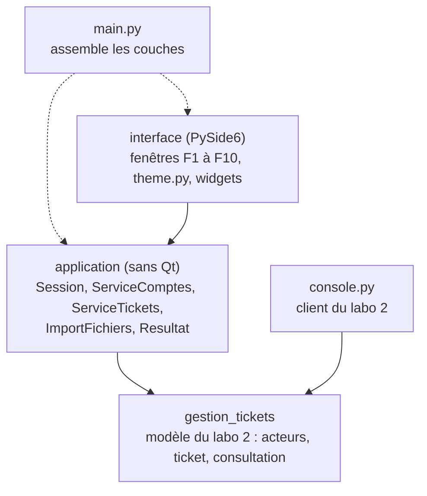

Les flèches pleines sont les dépendances entre couches ; un test vérifie qu'aucun import ne remonte les couches et que Qt n'apparaît que dans `interface`.

| Décision | Ce qu'elle rend facile à changer |
|---|---|
| PySide6 plutôt que tkinter | L'accessibilité (section 5). Qt lit aussi le JPG sans Pillow. |
| Couche application sans Qt : `Session`, `ServiceComptes`, `ServiceTickets`, `Resultat` | On peut changer de bibliothèque graphique sans toucher au modèle, et tester chaque action sans écran. |
| `allowed_actions` dans le modèle, calculé par les mêmes essais que les actions | Une règle d'état ou de rôle ajoutée au modèle met à jour les boutons, sans modifier l'interface. |
| `DescriptionVisitor` produit des blocs immuables (texte, image, commentaire) | Un nouveau type de contenu demande une méthode de visite et un bloc. L'interface ne reçoit jamais un objet du modèle. |
| `ImportFichiers` copie le fichier choisi sous un nom unique, puis appelle la Fabrique du labo 2 | La vérification (extension, signature, taille) reste à un seul endroit. |
| `theme.py` définit les onze jetons de couleur et la feuille de style | Changer la palette touche un seul fichier ; le contraste élevé consiste à ne pas l'appliquer. |

### Diagramme de classes v4

Le diagramme v4 (`docs/diagramme_v4.puml`) compte maintenant cinq paquetages, dont « Application » et « Interface », pour 62 classes.

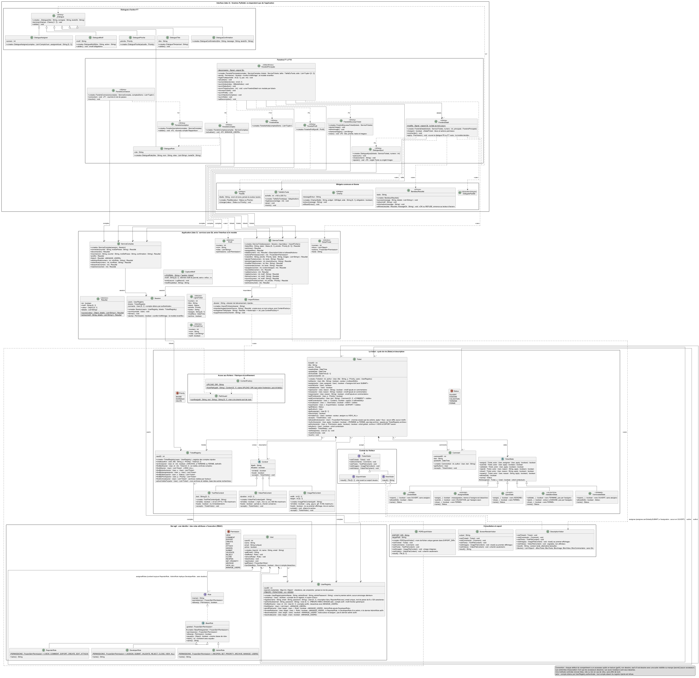

### Organisation du code

| Paquet | Rôle |
|---|---|
| `gestion_tickets` | Le modèle du labo 2, plus l'authentification, `allowed_actions` et `DescriptionVisitor` |
| `application` | Services sans Qt : `Session`, `ServiceComptes`, `ServiceTickets`, `ImportFichiers`, `Resultat` |
| `interface` | Fenêtres PySide6, `theme.py` (seul endroit où une couleur est écrite), `libelles.py`, widgets communs |
| `main.py` | Assemble les trois couches |
| `console.py` | La console du labo 2, branchée sur le même modèle |
| `donnees_demo.py` | Comptes, tickets et fichiers de départ |
| `outils` | `captures.py` (captures d'écran) et `mutation.py` (tests de mutation) |
| `docs` | Diagramme de classes v4 (`.puml` et `.png`) et captures d'écran |
| `tests` | 247 tests : modèle, application, console, interface, conformité au diagramme, architecture |

## 4. Connexion avec mot de passe

Nous avons retenu une vraie connexion par courriel et mot de passe (option B), plutôt que le choix d'un compte dans une liste comme dans la console du labo 2 (option A). Une interface graphique se prête à un vrai formulaire de connexion, et le rapport du labo 2 notait déjà qu'il faudrait une vraie authentification. Le reste du système n'a pas changé : la connexion donne le même objet `User` que l'option A, et toutes les règles du labo 2 s'appliquent ensuite.

| Choix | Pourquoi |
|---|---|
| Empreinte PBKDF2-HMAC-SHA256, sel aléatoire de 16 octets, 600 000 itérations | Recommandation OWASP 2023. Le mot de passe n'est jamais gardé en clair. |
| Nombre d'itérations gardé avec chaque empreinte | On peut augmenter le coût plus tard sans invalider les comptes existants. |
| Comparaison avec `hmac.compare_digest` | La durée de la comparaison ne révèle pas où l'empreinte diffère. |
| Courriel inconnu : une empreinte est quand même calculée | Un échec prend le même temps, que le compte existe ou non. |
| Motif d'échec unique : « courriel ou mot de passe incorrect » | On ne peut pas découvrir quels courriels ont un compte. |
| Mot de passe de 8 à 128 caractères, normalisé en Unicode NFKC | Longueurs de NIST SP 800-63B. Un « é » tapé de deux façons donne la même empreinte. |
| Empreintes marquées `{secret}` dans le diagramme, sans accesseur | Aucun code ne peut les lire, et un test le vérifie. |

Les cinq comptes de démonstration ont des mots de passe publics (`alice-2026`, etc.), listés dans F1 et F10. Ils ne servent qu'à la démonstration.

## 5. Accessibilité : WCAG 2.2 niveau AA

L'interface vise WCAG 2.2 niveau AA, appliqué à une application de bureau selon WCAG2ICT. C'est ce critère qui a fait choisir PySide6 : tkinter ne transmet pas le nom de ses contrôles aux lecteurs d'écran, et échoue donc au critère 4.1.2.

| Critère | Ce que fait l'interface | Vérifié par |
|---|---|---|
| 2.1.1 Clavier | Tout se fait au clavier : Tab, flèches, Entrée, Échap, Alt + lettre soulignée, Ctrl + N, F5, F1. | test de l'ordre de tabulation de F1 |
| 4.1.2 Nom, rôle et valeur | Chaque contrôle a un nom lu par NVDA et le Narrateur ; chaque image a un texte de remplacement. | test sur chaque contrôle focalisable ; UI Automation sous Windows : 31 contrôles de F1 et F3, aucun sans nom |
| 4.1.3 Messages d'état | Le résultat de chaque action est annoncé au lecteur d'écran sans déplacer le focus. | revue du code (`QAccessibleAnnouncementEvent`) |
| 1.4.3 et 1.4.11 Contraste | 4,5:1 au moins pour le texte, 3:1 pour les bordures ; le focus est un contour bleu de 2 px (`#0f62fe`). | test du contraste des onze jetons de `theme.py` |
| 1.4.1 Utilisation de la couleur | Le statut et la priorité ne sont jamais signalés par la seule couleur : chaque pastille a un libellé et une icône. | captures F3 et F10 |
| 1.4.4 Redimensionnement du texte | Le texte se règle de 100 % à 200 % (menu Affichage, Ctrl + +, Ctrl + -). | test à 200 % ; captures W1 et W2 |
| 2.5.8 Taille des cibles | Les boutons font 32 px de haut, pour un minimum exigé de 24 px. | test des cibles d'au moins 24 px |
| Contraste élevé de Windows | L'application n'applique pas sa feuille de style et reprend les couleurs du système. | test du mode contraste élevé (simulé) |

L'application a aussi été lancée sur un écran Windows réglé à 125 % : les fenêtres s'adaptent sans texte coupé. Restent à faire à la main : une écoute avec NVDA ou le Narrateur, un passage d'Accessibility Insights (FastPass), une mesure des contrastes à l'écran avec Colour Contrast Analyser, et un essai en vrai mode contraste élevé.

## 6. Captures d'écran de toutes les fenêtres

Les 25 captures montrent les dix fenêtres prévues, toutes implémentées, dans un état représentatif. Elles ont été prises sous Windows 11 par `python outils/captures.py`, avec les données de démonstration ; chaque refus affiché est un vrai refus du modèle.

### F1 et F2 : connexion et création de compte

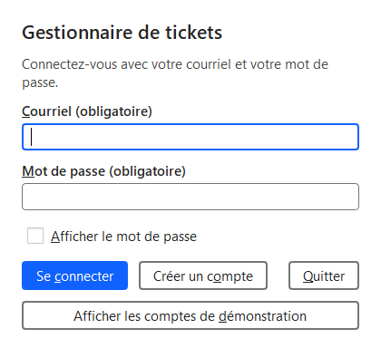

*Figure 1. F1 Connexion.*

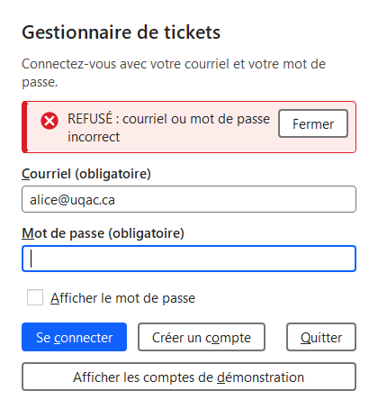

*Figure 2. F1 après un mauvais mot de passe : le motif reste générique.*

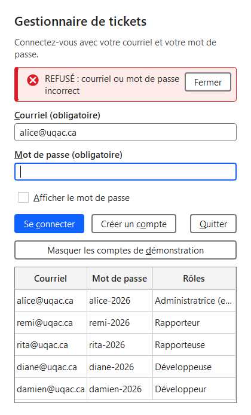

*Figure 3. F1 avec les comptes de démonstration ; un clic remplit les deux champs.*

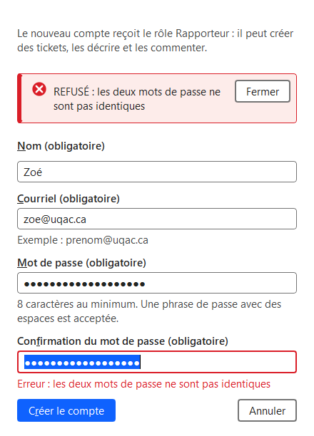

*Figure 4. F2 Créer un compte : l'erreur s'affiche sous le champ concerné.*

### F3 : fenêtre principale

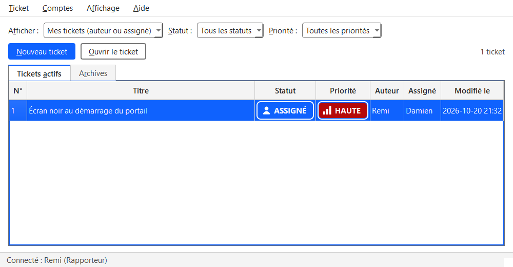

*Figure 5. F3 vue par un rapporteur (Remi) : il ne voit que son ticket, pas celui de Rita.*

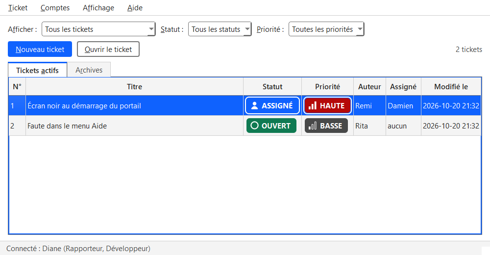

*Figure 6. F3 vue par une développeuse (Diane), filtre « Tous les tickets ».*

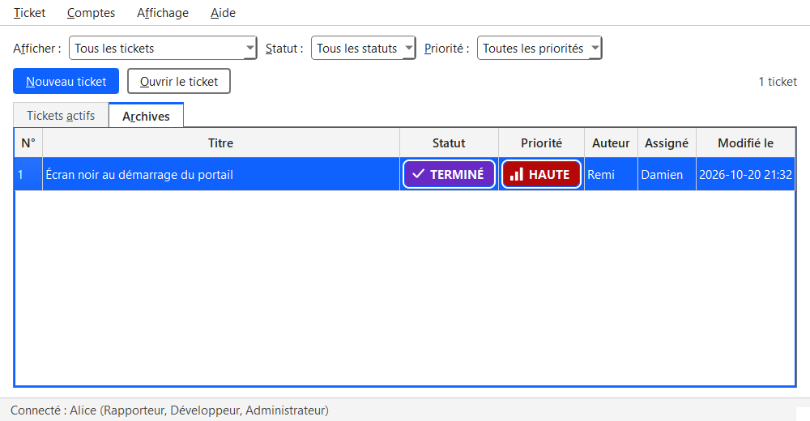

*Figure 7. F3, onglet Archives (Alice, administratrice).*

### F4 : détail d'un ticket

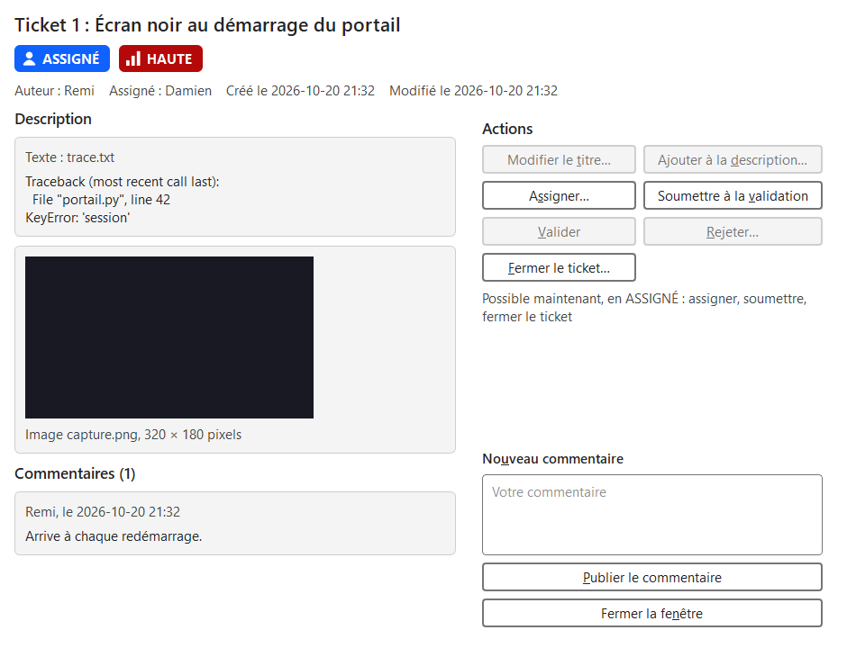

*Figure 8. F4 vue par l'assigné (Damien) : la ligne « Possible maintenant » énumère les actions.*

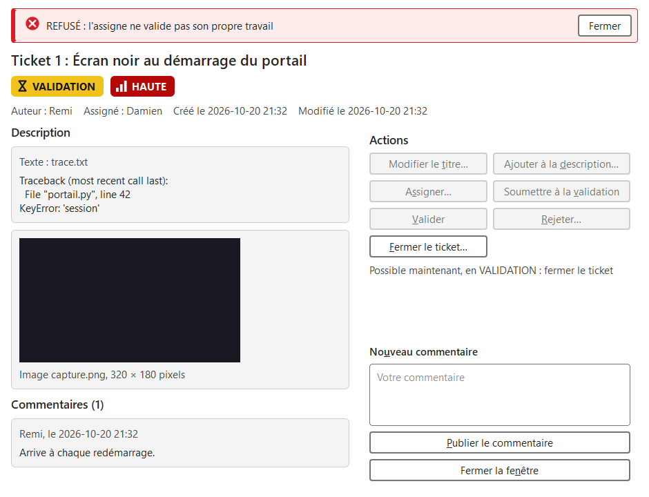

*Figure 9. F4 : l'assigné ne peut pas valider son propre travail, et le modèle le dit.*

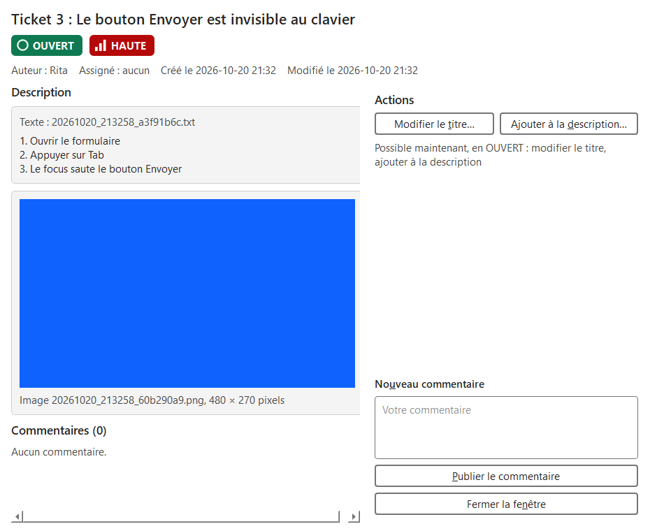

*Figure 10. F4 : une description faite d'un texte et d'une image.*

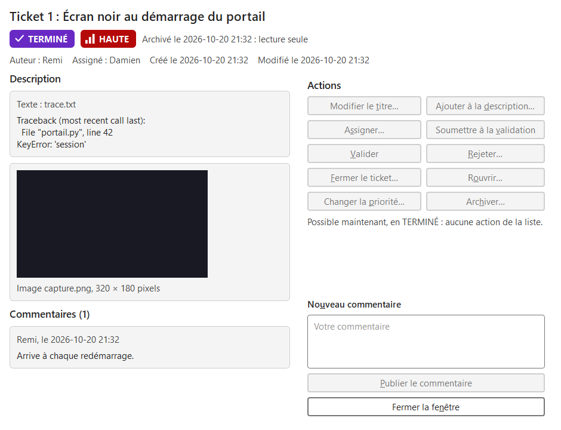

*Figure 11. F4 d'un ticket archivé : consultation seulement.*

### F5 et F6 : créer un ticket et compléter sa description

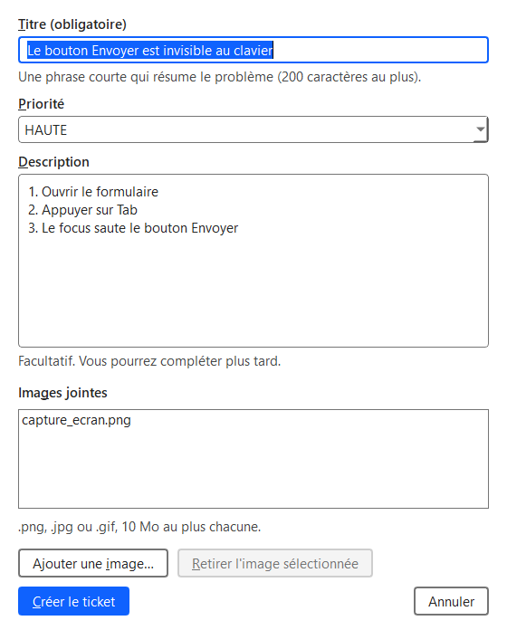

*Figure 12. F5 Nouveau ticket, avec texte et image dès la création.*

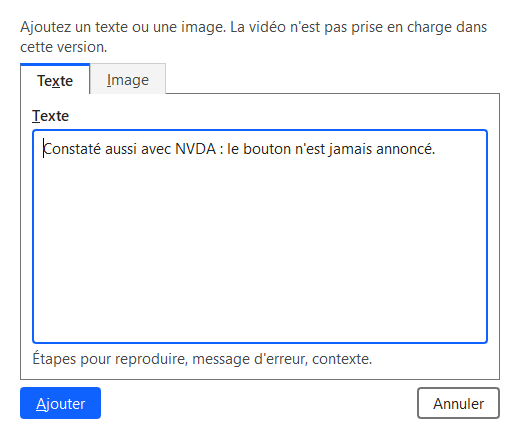

*Figure 13. F6 Ajouter à la description, onglet Texte.*

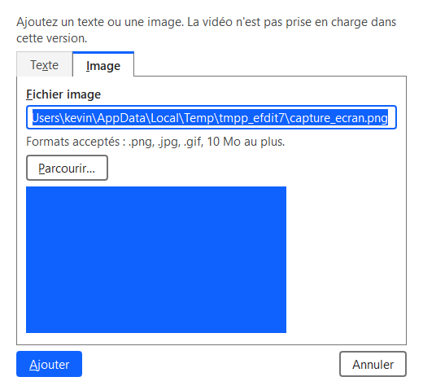

*Figure 14. F6 Ajouter à la description, onglet Image.*

### F7 : dialogues d'action

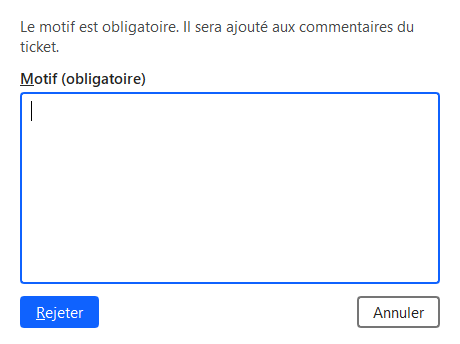

*Figure 15. F7 Motif d'un rejet (même dialogue pour fermer et rouvrir).*

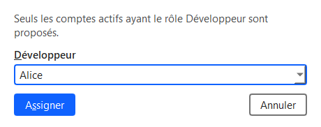

*Figure 16. F7 Assigner.*

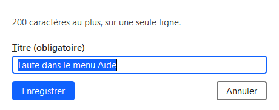

*Figure 17. F7 Modifier le titre.*

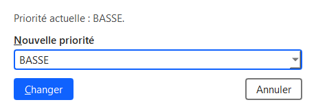

*Figure 18. F7 Changer la priorité.*

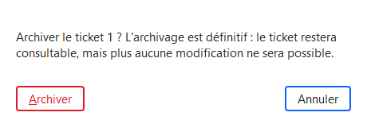

*Figure 19. F7 Confirmation avant l'archivage.*

### F8 à F10 : comptes, profil, aide

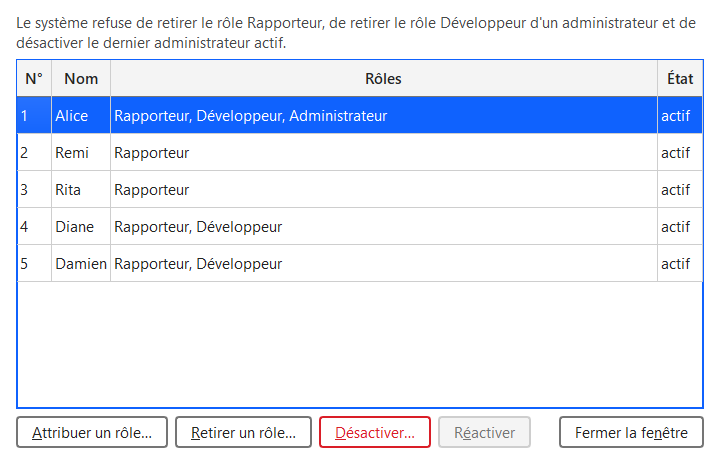

*Figure 20. F8 Gestion des comptes (MANAGE_USERS).*

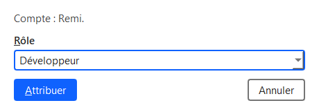

*Figure 21. F8 Attribuer un rôle.*

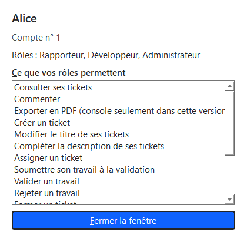

*Figure 22. F9 Mon profil.*

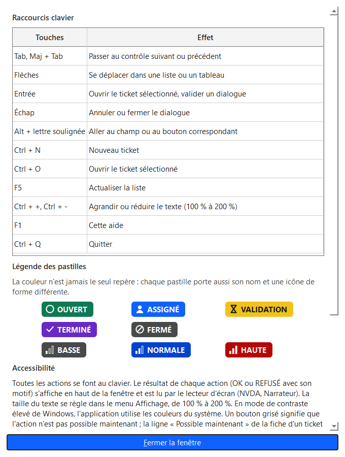

*Figure 23. F10 Aide et accessibilité (touche F1) ; la fenêtre défile.*

### Texte à 200 %

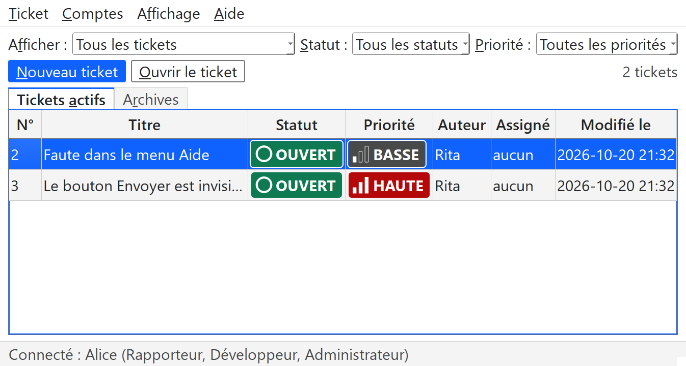

*Figure 24. F3 avec le texte à 200 %.*

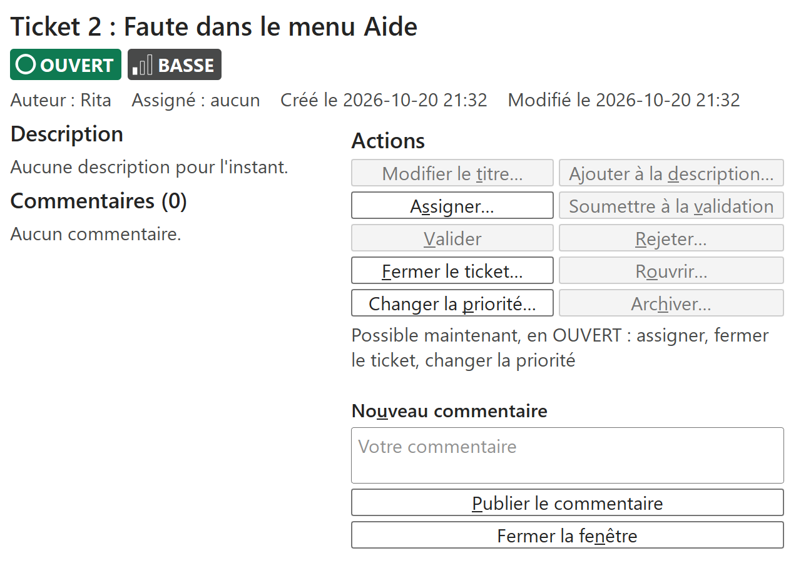

*Figure 25. F4 avec le texte à 200 %.*

## 7. Vérification

Les 247 tests passent sous Windows 11 avec Python 3.13 et PySide6 6.12 ; un seul est sauté, car Windows refuse de créer un lien symbolique sans droit d'administrateur. Ils couvrent le modèle, la couche application, la console et l'interface.

| Vérification | Ce qu'elle garantit | Résultat |
|---|---|---|
| Tests unitaires (13 fichiers) | Chaque règle du labo 2 et chaque service du labo 3 | 247 tests, 246 réussis, 1 sauté |
| `test_actions_permises` | Les boutons actifs sont exactement les actions que le modèle accepte | 546 cas (6 états × 7 acteurs × 13 actions), tous concordants |
| `test_conformite` | Le code suit le diagramme v4 : classes, héritages, opérations, visibilité, aucune méthode non déclarée | 62 classes sur 62, paquetage « Interface » compris |
| `test_architecture` | Aucun import ne remonte les couches ; Qt n'apparaît que dans `interface` | aucun écart |
| `test_interface` (21 tests, sans écran) | Noms accessibles, cibles, ordre de tabulation, texte à 200 %, contraste élevé, contrastes | tous réussis |
| Application lancée sous Windows | Démarrage, connexion, arbre UI Automation lu par les lecteurs d'écran | 31 contrôles focalisables dans F1 et F3, tous nommés |
| pyflakes | Aucun import ni variable inutile | 2 avertissements, deux imports voulus marqués `noqa` |

Le test sous Windows a trouvé un vrai défaut, invisible dans la machine virtuelle Linux : `PathGuard.confine` acceptait un nom de fichier contenant une demi-paire de substitution Unicode (`\ud800`), que Windows accepte et que Linux refuse. Il le refuse maintenant sur les deux systèmes.

### Tests de mutation

`outils/mutation.py` introduit 533 erreurs, une à la fois, dans le code ajouté au labo 3 : couche application, authentification, `allowed_actions` et `DescriptionVisitor`. Les tests en détectent 524 (98,3 %). Les 9 autres sont des mutations équivalentes, qui ne changent aucun comportement observable : toutes les erreurs qui changent le comportement sont détectées.

Chaque mutant change une seule expression : `==` devient `!=`, `<` devient `>=`, `and` devient `or`, `True` devient `False`, un entier augmente de 1, un `not` disparaît ou s'ajoute, un `return` renvoie `None`. Les tests tournent sur une copie du code, jamais sur l'original.

| Survivants | Pourquoi ils sont équivalents |
|---|---|
| 7 × `return False` devient `return None` dans les essais privés `__try_*` de `ticket.py` | Les appelants ne testent que la vérité du résultat, et les actions publiques renvoient leur propre `False`. |
| La valeur par défaut `apply=True` de `Ticket.__authorize` devient `False` | Chaque appel passe `apply` explicitement : la valeur par défaut ne sert jamais. |
| 99 devient 100 dans la clé de tri des rôles (`services.py`) | Les deux valeurs classent un rôle inconnu après les trois rôles connus. |

Le premier passage complet avait laissé 52 mutants vivants. La plupart montraient qu'un refus pouvait renvoyer `None` au lieu de `False`, ou perdre son motif, sans qu'aucun test le voie ; or l'interface affiche ce motif. Neuf tests ont été ajoutés, dont un qui vérifie le résultat et le motif de chacun des refus des 546 cas.

Un premier score de 98,7 % était faux. Avec onze copies en parallèle, la console dépassait son délai de 60 s, et ces échecs comptaient des mutants comme détectés. L'outil limite maintenant les tests de la console à deux copies à la fois.

## 8. Ce que nous avons appris

1. **Une couche sans Qt rend l'interface remplaçable.** La couche application fait de l'interface un simple client du modèle. La console et PySide6 tournent sur le même modèle, et les 34 tests de l'application n'ont besoin d'aucun écran.
2. **Demander au modèle ce qui est permis, plutôt que le recopier.** `allowed_actions` passe par les mêmes essais que les actions elles-mêmes. Les boutons et le modèle ne peuvent donc pas se contredire : 546 cas testés, tous concordants.
3. **Le Visiteur a servi une deuxième fois.** `DescriptionVisitor` a ajouté l'affichage graphique sans toucher `Ticket` ni les contenus, comme l'export PDF au labo 2. C'est la modificabilité promise par le patron.
4. **L'accessibilité se joue au choix de la bibliothèque.** Avec tkinter, le critère 4.1.2 aurait été hors d'atteinte quoi qu'on fasse ensuite. Avec PySide6, les tests automatiques ont trouvé deux défauts réels, des onglets et des zones de défilement sans nom, corrigés aussitôt.
5. **Tester sur la vraie plateforme.** Dans la machine virtuelle Linux, tout était vert. Sous Windows, un test de confinement des chemins échouait : Windows accepte un nom de fichier que Linux refuse. Nous refusons maintenant ces noms partout.
6. **Un seul endroit par décision.** `theme.py` est le seul fichier où une couleur est écrite, et `libelles.py` le seul où un rôle prend son accent. Changer la palette ou un libellé touche un seul fichier.
