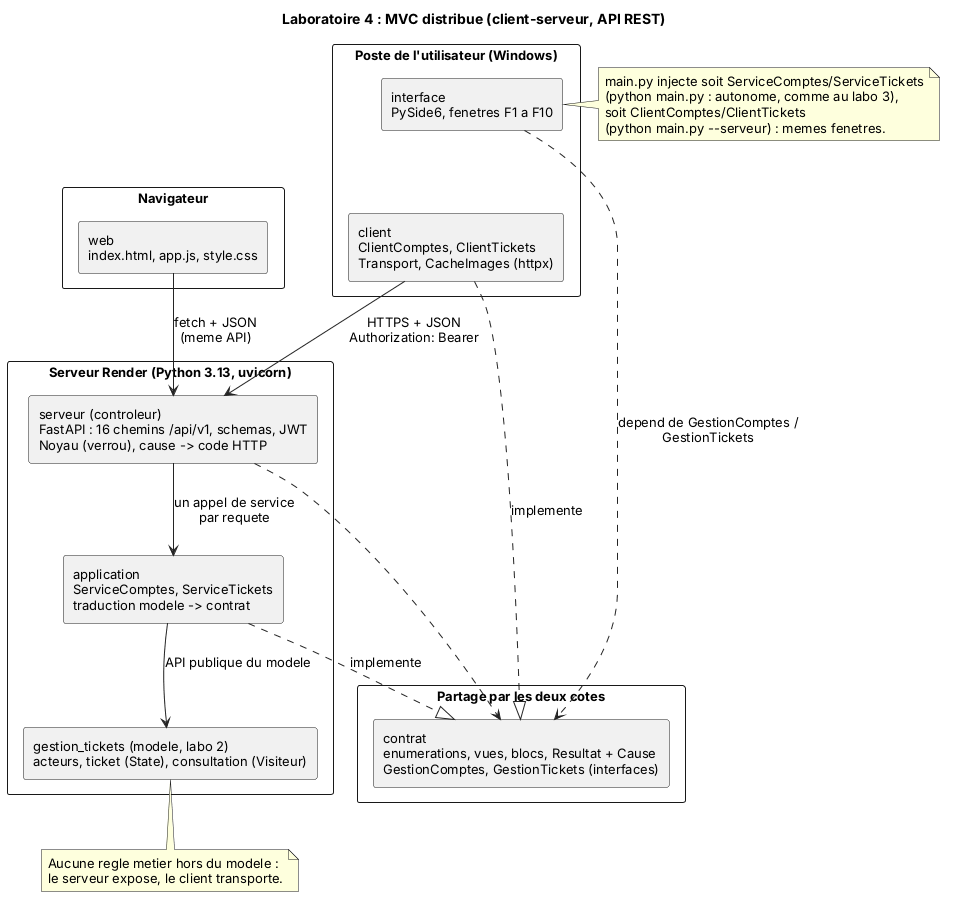
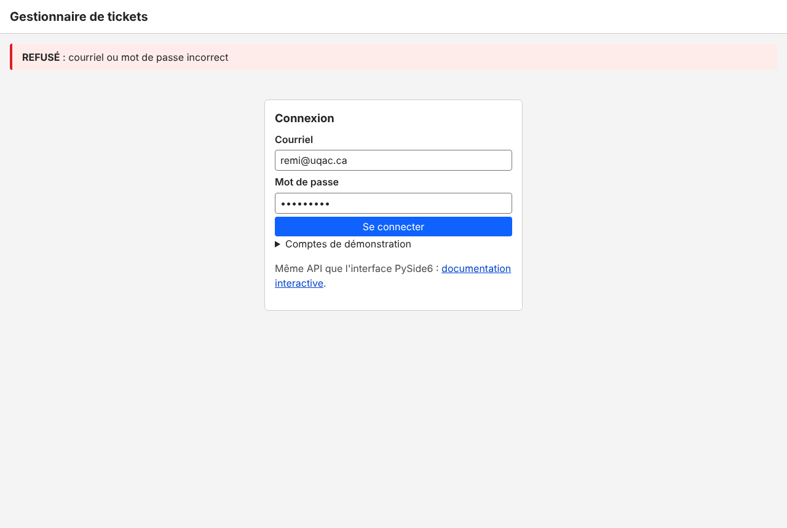
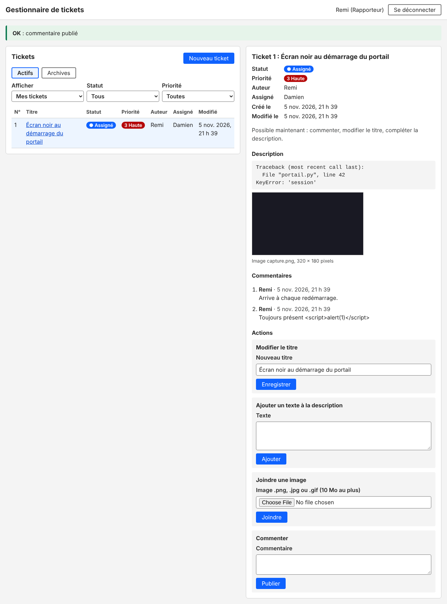
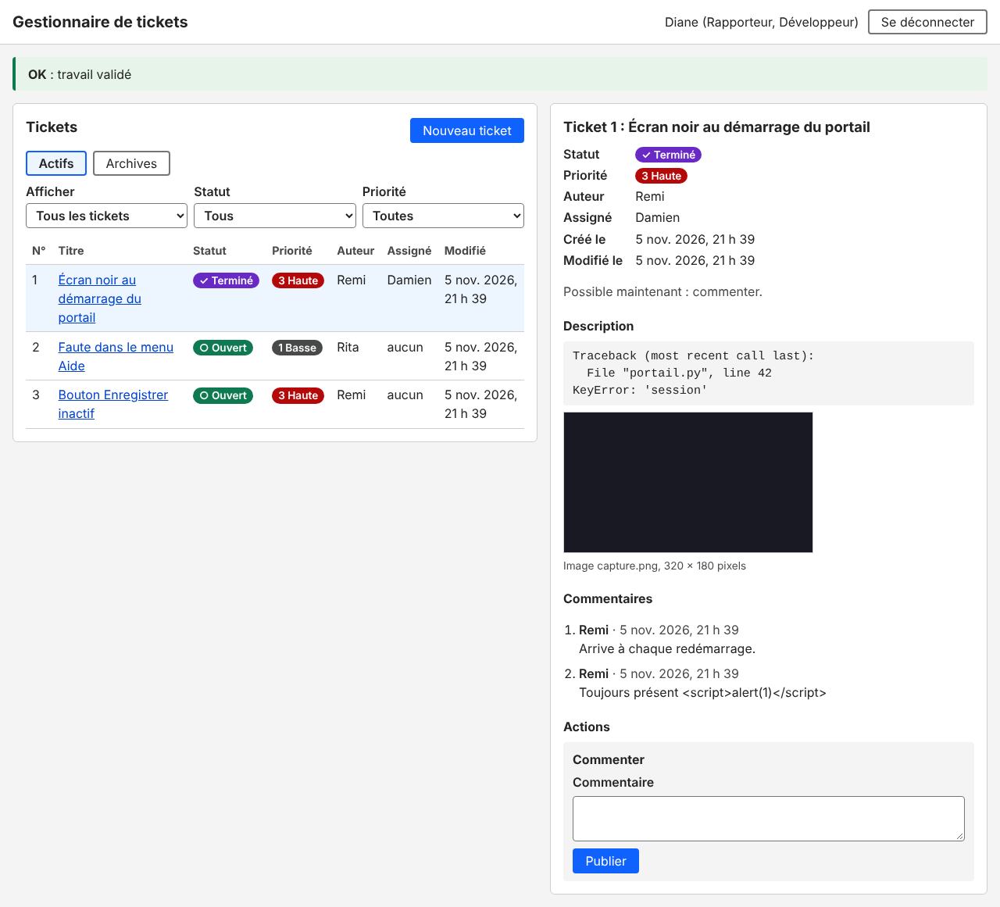
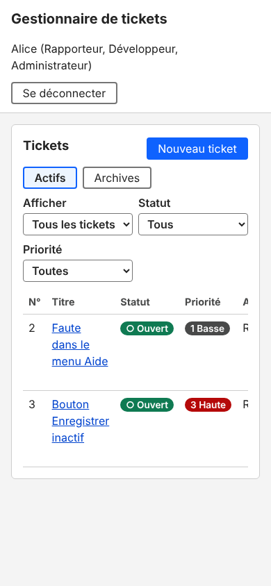

# Laboratoire 4 : API REST du gestionnaire de tickets (6GEI311)

Cours 6GEI311 Architecture des logiciels, UQAC, automne 2026.
Équipe : Christian Kevin Sawadogo et Jeremie Soppewe Arno Tchawo.

Le gestionnaire de tickets des labos 2 et 3 devient un système distribué. Le modèle tourne sur un serveur et s'expose par une API REST ; l'interface PySide6 du labo 3 l'utilise à distance sans qu'une seule fenêtre change ; une page web (bonus) utilise la même API. Le serveur est déployé sur Render. Les 316 tests passent.

- Page web : https://gestion-tickets-zmfy.onrender.com
- Documentation interactive de l'API : https://gestion-tickets-zmfy.onrender.com/docs
- Définition OpenAPI : [`docs/openapi.yaml`](docs/openapi.yaml)

Le service gratuit de Render s'endort après 15 minutes sans requête et met environ une minute à repartir. Au réveil, les données reviennent à l'état de démonstration.

## Sommaire

1. [Installation et utilisation](#1-installation-et-utilisation)
2. [Conception de l'API](#2-conception-de-lapi)
3. [Architecture MVC distribuée](#3-architecture-mvc-distribuée)
4. [Ce que l'intégration a changé](#4-ce-que-lintégration-a-changé)
5. [Déploiement sur Render](#5-déploiement-sur-render)
6. [Interface web (bonus)](#6-interface-web-bonus)
7. [Sécurité](#7-sécurité)
8. [Vérification](#8-vérification)

---

## 1. Installation et utilisation

Depuis ce dossier, avec Python 3.10 ou plus (3.13 conseillé) :

```
python -m venv .venv
.venv\Scripts\activate
pip install -r requirements-dev.txt
```

| Commande | Ce qu'elle lance |
|---|---|
| `python main.py` | L'interface PySide6 autonome, comme au labo 3 (le modèle tourne dans le même processus) |
| `python main.py --serveur` | L'interface PySide6, cliente de l'API déployée sur Render |
| `python main.py --serveur http://127.0.0.1:8000` | L'interface PySide6, cliente d'un serveur local |
| `uvicorn serveur.app:creer_api_demo --factory --reload` | Le serveur sur http://127.0.0.1:8000 (page web, `/docs`, API) |
| `python outils/verifier_deploiement.py [URL]` | Un parcours complet avec le vrai client, chronométré, sans rien modifier |
| `python console.py` | La console du labo 2 (locale) |

Trois fichiers de dépendances : `requirements.txt` pour le client (PySide6, httpx), `requirements-serveur.txt` pour le serveur (FastAPI, uvicorn, PyJWT ; c'est celui que Render installe), `requirements-dev.txt` pour tout, plus PyYAML pour l'export OpenAPI.

**Comptes de démonstration.** Cinq comptes et deux tickets existent au démarrage du serveur. Ces mots de passe sont publics et ne servent qu'à la démonstration.

| Courriel | Mot de passe | Rôles |
|---|---|---|
| alice@uqac.ca | alice-2026 | Administratrice (et Développeuse) |
| remi@uqac.ca | remi-2026 | Rapporteur |
| rita@uqac.ca | rita-2026 | Rapporteuse |
| diane@uqac.ca | diane-2026 | Développeuse |
| damien@uqac.ca | damien-2026 | Développeur |

**Essayer l'API à la main.** Sur `/docs`, envoyer `POST /api/v1/sessions` avec un compte, copier le jeton reçu dans le bouton **Authorize**, puis essayer n'importe quelle route.

## 2. Conception de l'API

Nous avons suivi les quatre étapes du cours (S6) : spécifier les ressources, leurs opérations, leurs URI, puis les arguments et la façon de les transmettre.

### Ressources

| Ressource | Attributs exposés | Échanges |
|---|---|---|
| Session | jeton, expiration, profil | ouvrir (se connecter) |
| Profil | numéro, nom, rôles, permissions | consulter |
| Compte | numéro, nom, rôles, actif | inscrire, lister, activer ou désactiver |
| Rôle d'un compte | nom | attribuer, retirer |
| Ticket | numéro, titre, statut, priorité, auteur, assigné, dates, actions permises | créer, lister, consulter, modifier le titre et la priorité |
| Contenu de la description | texte, ou image (nom, dimensions, URL), ou vidéo (nom) | lister, ajouter un texte, joindre une image |
| Image | octets de l'image | télécharger |
| Commentaire | numéro, auteur, date, texte | lister, publier |
| Transition | action, motif, assigné, statut obtenu | demander |
| Archive | ticket archivé | lister, archiver |

### Chemins et opérations (préfixe `/api/v1`)

| Méthode | Chemin | Arguments | Succès |
|---|---|---|---|
| POST | `/sessions` | body : courriel, mot_de_passe | 201 |
| GET | `/moi` | jeton | 200 |
| POST | `/comptes` | body : nom, courriel, mot_de_passe, confirmation | 201 |
| GET | `/comptes` | query : `assignables=true` (facultatif) | 200 |
| PATCH | `/comptes/{numero}` | url : numéro ; body : actif | 200 |
| POST | `/comptes/{numero}/roles` | url : numéro ; body : role | 201 |
| DELETE | `/comptes/{numero}/roles/{role}` | url : numéro, rôle | 204 |
| GET | `/tickets` | query : filtre, statut, priorite | 200 |
| POST | `/tickets` | body : titre, priorite, texte | 201 + `Location` |
| GET | `/tickets/{numero}` | url : numéro | 200 |
| PATCH | `/tickets/{numero}` | url : numéro ; body : titre et/ou priorite | 200 |
| GET | `/tickets/{numero}/contenus` | url : numéro | 200 |
| POST | `/tickets/{numero}/textes` | url : numéro ; body : texte | 201 |
| POST | `/tickets/{numero}/images` | url : numéro ; body multipart : fichier | 201 + `Location` |
| GET | `/tickets/{numero}/images/{nom}` | url : numéro, nom | 200, image |
| GET | `/tickets/{numero}/commentaires` | url : numéro | 200 |
| POST | `/tickets/{numero}/commentaires` | url : numéro ; body : texte | 201 |
| POST | `/tickets/{numero}/transitions` | url : numéro ; body : action, motif, assigne | 201 |
| GET | `/archives` | jeton | 200 |
| POST | `/archives` | body : numero | 201 + `Location` |
| GET | `/sante` | aucun | 200 |

Les règles du cours appliquées :

- chaque ressource a un URI qui donne toutes ses instances (`/comptes`, `/tickets`, `/archives`) ;
- une ressource composante est un sous-chemin de la ressource composée : contenus, images, commentaires et transitions sous `/tickets/{numero}` (principe Créateur de GRASP) ;
- in url pour désigner une instance, in query pour un algorithme (les filtres de la liste), in body pour POST, PUT et PATCH ;
- une seule façon de faire chaque chose : les archives se lisent par `/archives`, pas par un filtre de `/tickets`.

Les transitions du cycle de vie forment une ressource à part. Une transition n'est ni une lecture ni la modification libre d'un attribut : c'est une demande que le modèle (patron State) accepte ou refuse selon l'état du ticket et les rôles du compte.

### Codes de réponse

Une erreur a toujours la même forme : `{"motif": "...", "details": [...], "cause": "..."}`. Le motif est celui que le modèle écrit, comme dans le bandeau REFUSÉ du labo 3.

| Code | Cause | Quand |
|---|---|---|
| 401 | NON_CONNECTE | jeton absent, invalide ou expiré ; compte désactivé ; mauvais mot de passe |
| 403 | INTERDIT | les rôles du compte n'accordent pas la permission |
| 404 | INTROUVABLE | ressource inexistante, ou invisible pour ce compte (son existence n'est pas révélée) |
| 409 | CONFLIT | la permission est accordée, mais ce ticket ne le permet pas maintenant (état, auteur, assigné) |
| 422 | INVALIDE | corps mal formé, ou argument refusé par le modèle (titre vide, fichier refusé) |

## 3. Architecture MVC distribuée



| Rôle MVC | Paquet | Contenu |
|---|---|---|
| Modèle (couche métier) | `gestion_tickets`, `application` | Le modèle du labo 2, inchangé, et les services du labo 3 ; ils ne tournent que sur le serveur |
| Contrôleur | `serveur` | FastAPI : 16 chemins, jetons, verrou, traduction d'un refus en code HTTP ; aucune règle métier |
| Vue | `interface`, `client`, `web` | Les fenêtres PySide6, les services distants qu'elles utilisent, la page web |
| Contrat | `contrat` | Ce que client et serveur échangent : énumérations, vues, blocs, `Resultat` et sa cause, interfaces `GestionComptes` et `GestionTickets` |

Les fenêtres dépendent des interfaces `GestionComptes` et `GestionTickets` du contrat, pas d'une implémentation. Deux implémentations existent : `ServiceComptes` et `ServiceTickets` (le modèle dans le processus) et `ClientComptes` et `ClientTickets` (le modèle derrière l'API, patron Proxy). `main.py` choisit laquelle injecter.

| Décision | Pourquoi |
|---|---|
| Contrat partagé, sans dépendance | Le client ne contient pas le modèle et ne peut pas le contourner. Le serveur traduit le modèle vers le contrat (`application/traduction.py`), le client reconstruit le contrat depuis le JSON. |
| Une cause dans chaque refus | Le serveur choisit le code HTTP par une seule table, sans recopier aucune règle. La cause vient de ce que le modèle dit lui-même (`can_globally`, `allowed_actions`). |
| FastAPI | La définition OpenAPI et la page `/docs` sont générées depuis le code et ne peuvent pas en diverger. |
| Jeton signé (JWT HS256), 8 h | REST est sans état : chaque requête porte l'identité du compte. Se déconnecter consiste à oublier le jeton. |
| Un verrou autour du modèle | FastAPI traite les requêtes dans plusieurs fils ; le modèle n'est pas prévu pour cela, et les motifs de refus passent par un journal partagé. |
| Données en mémoire | Le disque de Render gratuit est éphémère ; le système repart des données de démonstration. |

Le diagramme de classes v5 ([`docs/diagramme_v5.puml`](docs/diagramme_v5.puml), [image](docs/diagramme_v5.png)) compte 77 classes en neuf paquetages. Un test vérifie que le code le suit exactement, paquetages Contrat, Serveur et Client compris.

## 4. Ce que l'intégration a changé

| Partie | Modification |
|---|---|
| Modèle (`gestion_tickets`) | Aucune. |
| Application | Les services rendent des types du contrat et fixent la cause de chaque refus ; `commenter` rend le commentaire publié ; `ServiceComptes` et `ServiceTickets` implémentent les interfaces du contrat. |
| Interface PySide6 | Dix lignes d'import (de `application` vers `contrat`) ; une fenêtre d'attente pendant le réveil du serveur. Aucune fenêtre modifiée. |
| `main.py` | `--serveur [URL]` injecte les clients distants au lieu des services locaux. |
| Nouveau : `serveur` | API REST, jetons, verrou, schémas JSON, page web. |
| Nouveau : `client` | Services distants : délai de 10 s, réveil de 90 s, pannes du réseau dans le bandeau, cache local des images. |
| Nouveau : `web` | Page web (bonus). |

## 5. Déploiement sur Render

| Réglage | Valeur |
|---|---|
| Dépôt, branche | `Mrpropre12/lab-architecture-de-logiciel`, `lab4` (dépôt public) |
| Root Directory | `Laboratoire_4/code` |
| Build Command | `pip install -r requirements-serveur.txt` |
| Start Command | `python -m uvicorn serveur.app:creer_api_demo --factory --host 0.0.0.0 --port $PORT` |
| Variables | `PYTHON_VERSION=3.13.5`, `TICKETS_SECRET` (au moins 32 caractères) |
| Health Check Path | `/api/v1/sante` |

Le dépôt étant public, Render ne redéploie pas à chaque push : « Manual Deploy » après chaque changement. Durées mesurées par `outils/verifier_deploiement.py` :

| Où | Connexion | Autres requêtes |
|---|---|---|
| Serveur local (uvicorn) | 0,14 s | 3 ms |
| Render, offre gratuite | 1,3 s | 125 à 350 ms |

La connexion est lente sur Render parce que le hachage des mots de passe (PBKDF2, 600 000 itérations, recommandation OWASP) tourne sur un processeur partagé. Nous l'avons gardé : 1,3 s une fois par session reste acceptable. Les autres durées viennent surtout de l'aller-retour réseau.

## 6. Interface web (bonus)

La page est servie par le même serveur, à la racine, et utilise la même API que le client PySide6. Elle ne propose que les actions que le modèle permet maintenant, et affiche OK, ou REFUSÉ avec le motif du modèle.



*Figure 1. Connexion : un mauvais mot de passe donne le motif générique du modèle.*



*Figure 2. Remi (rapporteur) : son seul ticket, l'image téléchargée avec le jeton, un commentaire contenant `<script>` affiché comme du texte.*



*Figure 3. Diane (développeuse) après la validation : le ticket est TERMINÉ.*



*Figure 4. Sur un téléphone (390 px) : aucune barre de défilement horizontale pour la page.*

## 7. Sécurité

| Mesure | Effet |
|---|---|
| Jeton JWT HS256, secret d'au moins 32 octets, durée 8 h | Une requête sans jeton valide reçoit 401 ; un jeton d'un autre serveur ou expiré est refusé. |
| Compte vérifié à chaque requête | Un compte désactivé perd l'accès immédiatement, même avec un jeton encore valide. |
| 404 pour un ticket invisible | On ne peut pas découvrir qu'un ticket existe. |
| Images servies seulement par leur nom dans le modèle, et seulement si le ticket est visible | Aucun chemin n'est construit depuis l'URL ; pas d'accès aux images d'un ticket qu'on ne voit pas. |
| Taille d'une image limitée à 10 Mo avant lecture | Comme la fabrique du labo 2. |
| Page web : `textContent` seulement, politique CSP stricte | Une donnée reçue ne peut pas devenir du HTML ni du script ; un test le vérifie. |
| Mots de passe hachés (PBKDF2), HTTPS sur Render | Inchangé depuis le labo 3 ; en local, le serveur n'est pas chiffré : comptes de démonstration seulement. |

## 8. Vérification

| Vérification | Ce qu'elle garantit | Résultat |
|---|---|---|
| 247 tests du labo 3 | Le modèle, les services et l'interface n'ont pas régressé | tous réussis |
| `test_api` (31 tests) | Chaque chemin, chaque code de réponse, la forme des erreurs, la page web | tous réussis |
| `test_client` (34 tests) | Les tests de la couche application rejoués à travers l'API : mêmes résultats et mêmes motifs qu'en local ; pannes du réseau | tous réussis |
| `test_reveil` (4 tests) | Réveil du serveur sans figer l'écran, point d'entrée | tous réussis |
| Test du verrou | 40 requêtes en parallèle gardent chacune leur motif ; retiré, le verrou fait échouer le test | réussi (échoue sans verrou) |
| `test_conformite` | Le code suit le diagramme v5 | 77 classes sur 77 |
| `test_architecture` | Le contrat ne dépend de rien ; la vue ne voit jamais le modèle ; Qt, FastAPI et httpx restent dans leur paquet | aucun écart |
| Essai dans Chromium | Parcours complet de la page web par quatre comptes, téléphone compris | aucune erreur |
| `outils/verifier_deploiement.py` sur Render | Le service déployé se comporte comme en local | 12 vérifications sur 12 |

Le README du labo 3 (fenêtres, accessibilité, tests de mutation) est conservé dans [`docs/README_labo3.md`](docs/README_labo3.md).
