# Laboratoire 2 : système de gestion de tickets (6GEI311)

Cours 6GEI311 Architecture des logiciels, UQAC, automne 2026.
Équipe : Christian Kevin Sawadogo et Jeremie Soppewe Arno Tchawo.

Ce dépôt contient les deux parties du laboratoire 2 :

- **Partie 1** (`Partie_1/`) : l'implémentation en Python du diagramme de classes fourni par l'énoncé, avec un programme principal interactif ;
- **Partie 2** (`Partie_2/`) : la conception améliorée. La description d'un ticket accepte du texte, des images et des vidéos ; elle se consulte à l'écran ou s'exporte en PDF. Le dossier contient aussi le nouveau diagramme et le rapport.

## Sommaire

1. [Installation et utilisation](#1-installation-et-utilisation)
2. [Ce que nous avons appris](#2-ce-que-nous-avons-appris)
3. [Résultats](#3-résultats)
4. [Organisation du dépôt](#4-organisation-du-dépôt)

---

## 1. Installation et utilisation

### 1.1 Prérequis

- Python 3.10 ou plus récent (`python --version`).
- Git, pour cloner le dépôt.
- Partie 2 seulement : la bibliothèque `fpdf2`, qui sert à l'export PDF. Elle s'installe avec `requirements.txt`.

```
git clone https://github.com/Mrpropre12/lab-architecture-de-logiciel.git
cd lab2-architecture-de-logiciel
```

### 1.2 Partie 1

Aucune bibliothèque externe n'est nécessaire.

```
cd Partie_1
python main.py
```

Au démarrage, le programme crée deux utilisateurs et un administrateur :

| Rôle | Identifiant | Nom |
|---|---|---|
| Utilisateur | 1 | Alice Tremblay |
| Utilisateur | 2 | Marc Bouchard |
| Administrateur | 1 | Bob Gagnon |

Utilisation :

1. Choisir `1. Je suis un utilisateur` ou `2. Je suis un admin`, puis entrer son identifiant.
2. Un utilisateur peut créer un ticket, voir l'état d'un ticket et changer son statut (VALIDATION ou TERMINÉ).
3. Un administrateur peut assigner un ticket à un utilisateur (statut ASSIGNÉ), fermer un ticket (statut FERMÉ) et voir tous les tickets.
4. `0` revient au menu d'authentification ; `0` à ce menu quitte le programme.

Les tickets reçoivent des numéros à partir de 101.

### 1.3 Partie 2

```
cd Partie_2/code
pip install -r requirements.txt
python main.py
```

Sans `fpdf2`, tout fonctionne sauf la production du fichier PDF.

**Comptes de départ.** Cinq comptes et deux tickets existent déjà au lancement.

| Identifiant | Nom | Rôles |
|---|---|---|
| 1 | Alice | Administratrice (elle a aussi les rôles Développeur et Rapporteur) |
| 2 | Remi | Rapporteur |
| 3 | Rita | Rapporteur |
| 4 | Diane | Développeur |
| 5 | Damien | Développeur |

Le ticket 1 (auteur Remi, priorité HAUTE) contient un fichier texte, une image et un commentaire ; il est assigné à Damien. Le ticket 2 (auteur Rita, priorité BASSE) est ouvert.

**Navigation.**

1. Menu d'accueil : `1. Se connecter`, puis entrer l'identifiant du compte. Se connecter consiste à choisir un compte, car l'authentification est hors du périmètre du diagramme. `2. Créer un compte` inscrit un nouveau compte avec le rôle Rapporteur.
2. Le menu ne montre que les actions permises par les rôles du compte connecté. Les numéros des actions ne changent jamais : `12` est toujours « Soumettre », `13` toujours « Valider ».
3. La touche `T` affiche aussi les actions hors des rôles, marquées `*`, pour voir le système les refuser.
4. Chaque action s'affiche sur son propre écran, avec le résultat : `OK`, ou `REFUSE` suivi du motif donné par le système. Entrée ramène au menu, qui rappelle la dernière action.
5. Pour joindre un fichier, on donne son nom : il doit se trouver dans `donnees/televersements` (créé au premier lancement avec `trace.txt`, `capture.png`, `demo.mp4` et `virus.exe`). Les PDF sont écrits dans `donnees/exports`.

**Scénario de démonstration** (il reproduit les captures de la section 3.2) :

| Étape | Compte | Saisies | Résultat attendu |
|---|---|---|---|
| 1 | Rita (3) | `5`, titre, `haute` | OK : ticket 3 créé |
| 2 | Rita | `9`, `3`, `trace.txt` | OK : texte joint |
| 3 | Rita | `9`, `3`, `virus.exe` | REFUSE : extension non prise en charge |
| 4 | Remi (2) | `6`, `1` | OK : le ticket s'affiche avec texte, image et commentaire |
| 5 | Remi | `T`, `12`, `1` | REFUSE : SUBMIT, permission absente |
| 6 | Damien (5) | `12`, `1` | OK : ticket en VALIDATION |
| 7 | Damien | `13`, `1` | REFUSE : l'assigné ne valide pas son propre travail |
| 8 | Diane (4) | `13`, `1` | OK : ticket TERMINÉ |
| 9 | Alice (1) | `18`, `1` | OK : ticket archivé (définitif) |
| 10 | Remi | `10`, `1`, un texte | REFUSE : ticket archivé, lecture et export seulement |
| 11 | Remi | `7`, `1` | OK : PDF créé dans `donnees/exports` |

### 1.4 Lancer les tests

```
cd Partie_2/code
python -m unittest discover -s tests
```

Résultat attendu : `Ran 157 tests` puis `OK`. Les tests du PDF sont ignorés (`skipped`) quand fpdf2 n'est pas installé.

| Fichier | Ce qu'il vérifie |
|---|---|
| `test_conformite.py` | Chaque classe, attribut et méthode du fichier `diagramme_uml.puml` existe dans le code |
| `test_architecture.py` | Les dépendances entre paquets vont dans un seul sens |
| autres `test_*.py` | Les règles métier (rôles, états du ticket, contenus, archivage, consultation, export) et la console |

---

## 2. Ce que nous avons appris

**Partie 1 : traduire un diagramme en code.**

- Passer d'un diagramme UML à Python demande des conventions claires : un attribut public devient un attribut Python, une méthode `void` ne renvoie rien, une association devient une référence ou une liste.
- Coder fidèlement un diagramme fait apparaître ses défauts. Avec un statut en chaîne de caractères, n'importe quelle valeur passe, et rien n'empêche d'aller d'OUVERT à TERMINÉ sans VALIDATION. La classe Admin recopie les attributs de User au lieu de partager un rôle. Ces constats ont servi de critique au début de la partie 2.
- Un programme principal interactif est une bonne façon de vérifier une à une les méthodes devant l'auxiliaire.

**Partie 2 : améliorer la conception pour la modificabilité.**

- **Critiquer un diagramme, c'est le confronter à l'énoncé.** Chaque phrase de l'énoncé (qui assigne, qui valide, quels statuts) doit trouver sa place dans le modèle.
- **Une chaîne de caractères cache une décision.** Remplacer `status` et `role` par des types (patron État, rôles et permissions) rend une transition interdite impossible à écrire.
- **Un patron se justifie par un changement probable.**
  - État : ajouter un statut ne touche que les états.
  - Fabrique : ajouter un type de fichier ne touche que la fabrique.
  - Visiteur : ajouter un format d'affichage ou d'export ne touche ni Ticket ni les contenus.
  - RBAC : ajouter un rôle revient à ajouter une classe.

  À l'inverse, nous avons retiré un Singleton qui n'apportait que de l'état global, au profit de l'injection du registre des comptes.
- **Le code corrige aussi le diagramme.** L'implémentation a fait remonter des oublis, et nous avons mis le diagramme à jour en même temps que le code.
- **Les tests prouvent la conformité.** Un test qui relit le fichier PlantUML a vérifié que les 30 classes du diagramme existent dans le code avec leurs méthodes. Des tests de mutation ont montré que chaque règle importante est réellement testée.
- **L'interface n'est pas une barrière de sécurité.** Masquer une action dans le menu améliore le confort, mais c'est le modèle qui doit refuser. Une relecture par un regard extérieur a trouvé des défauts que nos propres tests ne visaient pas.

---

## 3. Résultats

### 3.1 Partie 1

#### Diagramme de classes (fourni par l'énoncé)

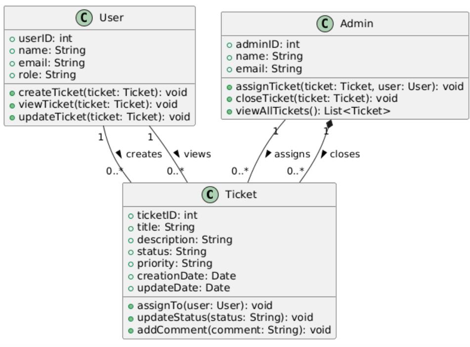

#### Conformité du code au diagramme

| Classe | Fichier | Attributs | Méthodes | Conforme |
|---|---|---|---|---|
| User | `Partie_1/user.py` | `userID`, `name`, `email`, `role` | `createTicket`, `viewTicket`, `updateTicket` | oui |
| Admin | `Partie_1/admin.py` | `adminID`, `name`, `email` (+ la liste des tickets, pour `viewAllTickets`) | `assignTicket`, `closeTicket`, `viewAllTickets` | oui |
| Ticket | `Partie_1/ticket.py` | `ticketID`, `title`, `description`, `status`, `priority`, `creationDate`, `updateDate` | `assignTo`, `updateStatus`, `addComment` | oui |

`Partie_1/main.py` crée les objets de départ et offre un menu par rôle qui appelle chacune de ces méthodes.

#### Fonctionnalités et captures

| Fonctionnalité | Méthodes appelées | Capture |
|---|---|---|
| Choisir son rôle | | Figure 1 |
| Connexion d'un utilisateur et menu | | Figure 2 |
| Créer un ticket | `Ticket(...)`, `User.createTicket` | Figure 3 |
| Voir l'état d'un ticket | `User.viewTicket` | Figure 4 |
| Changer le statut | `Ticket.updateStatus` | Figure 5 |
| Connexion d'un administrateur et menu | | Figure 6 |
| Assigner un ticket | `Admin.assignTicket`, `Ticket.assignTo` | Figure 7 |
| Fermer un ticket | `Admin.closeTicket`, `Ticket.updateStatus` | Figure 8 |
| Voir tous les tickets | `Admin.viewAllTickets` | Figure 9 |

**Figure 1.** Menu d'authentification
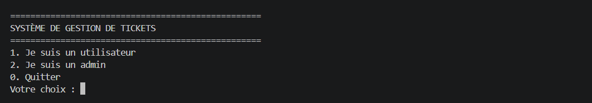

**Figure 2.** Connexion d'Alice et menu utilisateur
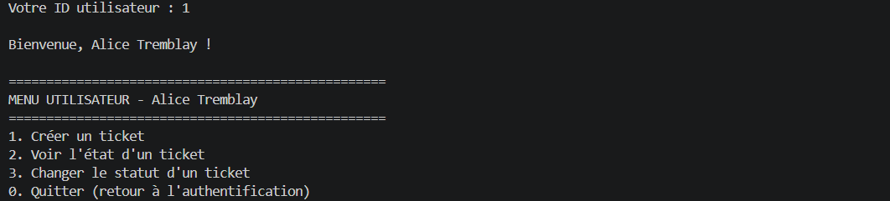

**Figure 3.** Création d'un ticket
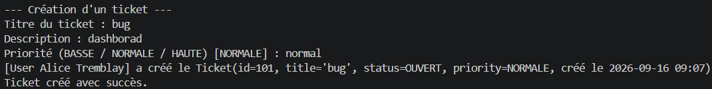

**Figure 4.** Consultation d'un ticket
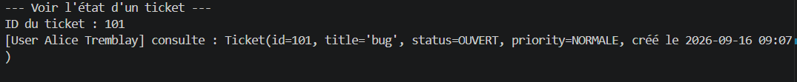

**Figure 5.** Changement de statut vers VALIDATION
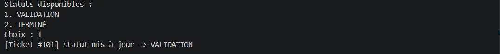

**Figure 6.** Connexion de l'administrateur Bob et menu administrateur
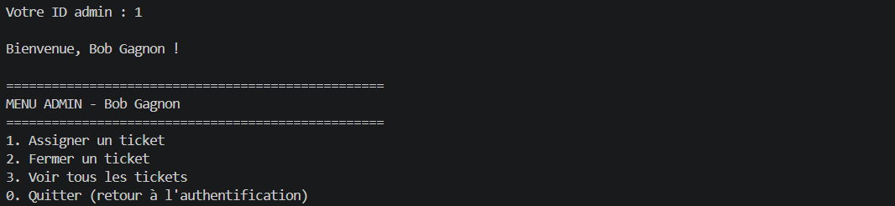

**Figure 7.** Assignation du ticket 101 à Alice (statut ASSIGNÉ)
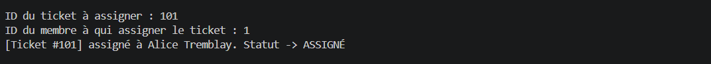

**Figure 8.** Fermeture du ticket 101 (statut FERMÉ)
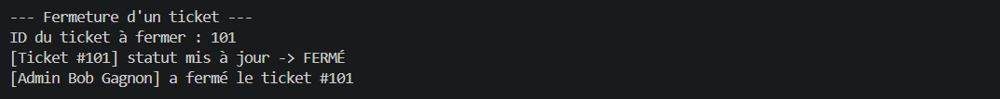

**Figure 9.** Liste de tous les tickets
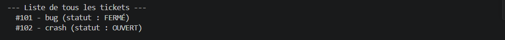

### 3.2 Partie 2

#### Diagramme de classes amélioré


Le source PlantUML est dans `Partie_2/diagramme_uml.puml`. Le rapport (`Partie_2/Rapport_Lab2_6GEI311.pdf`) présente la critique du diagramme initial, le tableau des justifications de chaque changement et les leçons apprises.

Le diagramme compte 30 classes réparties en trois paquetages :

| Paquetage | Classes | Bonne pratique appliquée |
|---|---|---|
| Qui agit | `Permission`, `Role`, `BaseRole`, `ReporterRole`, `DeveloperRole`, `AdminRole`, `User`, `UserRegistry` | Contrôle d'accès par rôles (RBAC) par composition, plutôt qu'une classe Admin séparée |
| Le ticket | `Ticket`, `Comment`, `Priority`, `TicketRegistry`, `TicketState` et ses cinq états, `Status`, `Content` et ses trois types, `ContentFactory`, `PathGuard`, contrat du Visiteur | Patron État pour le cycle de vie, Fabrique pour les fichiers joints, archivage plutôt que suppression |
| Consultation et export | `ScreenRenderVisitor`, `PDFExportVisitor` | Patron Visiteur : afficher ou exporter sans modifier Ticket |

#### Correspondance du diagramme et du code

| Paquetage UML | Paquet Python |
|---|---|
| Qui agit | `Partie_2/code/gestion_tickets/acteurs/` |
| Le ticket | `Partie_2/code/gestion_tickets/ticket/` |
| Consultation et export | `Partie_2/code/gestion_tickets/consultation/` |

Conventions : `+ nom` devient `nom`, `~ nom` devient `_nom`, `- nom` devient `__nom` ; `camelCase` devient `snake_case` (PEP 8) ; `<<create>>` devient `__init__`. Une suite de 157 tests, rangée dans `Partie_2/code/tests`, vérifie la conformité au diagramme (30 classes sur 30), les règles métier et le sens des dépendances entre paquets. La section 1.4 explique comment la lancer.

#### Fonctionnalités et captures

| Exigence de l'énoncé | Implémentation | Capture |
|---|---|---|
| Créer un ticket au statut OUVERT | `TicketRegistry.create`, `OpenState` | Figure 14 |
| Description en texte, images ou vidéos (chemins des fichiers, chargements différents) | `ContentFactory.from_path` crée `TextFileContent` (lu tout de suite), `ImageFileContent` (lu au premier affichage) ou `VideoFileContent` (jamais lu) ; un fichier dangereux est refusé | Figure 15 |
| Consulter la description sur la plateforme | `Ticket.consult` avec `ScreenRenderVisitor` | Figure 16 |
| Exporter la description en PDF | `Ticket.export` avec `PDFExportVisitor` | Figures 21 et 22 |
| Assigner, soumettre, valider, fermer | Patron État : `AssignedState`, `ValidationState`, `TerminatedState`, `ClosedState` | Figures 18 et 19 |
| Seul un autre développeur valide le travail de l'assigné | `ValidationState.validate` | Figure 18 |
| Droits selon le rôle | `User.can_globally` et les permissions de chaque rôle ; le menu s'adapte | Figures 11 à 13 et 17 |
| Garder la trace des tickets résolus | `TicketRegistry.archive` : ticket en lecture seule | Figure 20 |

Les figures suivantes sont la sortie réelle de la console pour le scénario de la section 1.3, mise en image.

**Figure 10.** Accueil et choix du compte
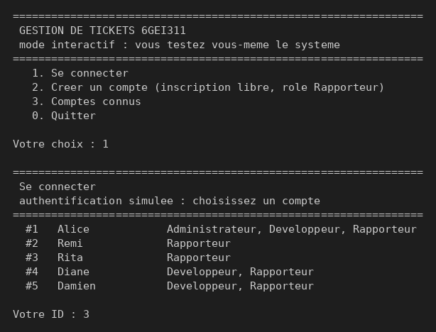

**Figure 11.** Menu d'une rapporteuse : seules les actions de son rôle apparaissent
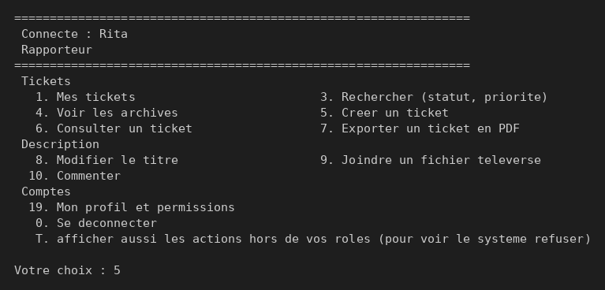

**Figure 12.** Menu d'un développeur
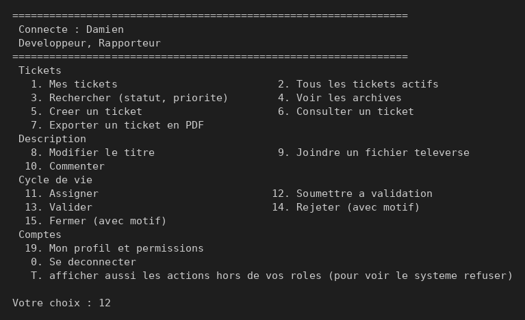

**Figure 13.** Menu de l'administratrice : les 24 actions
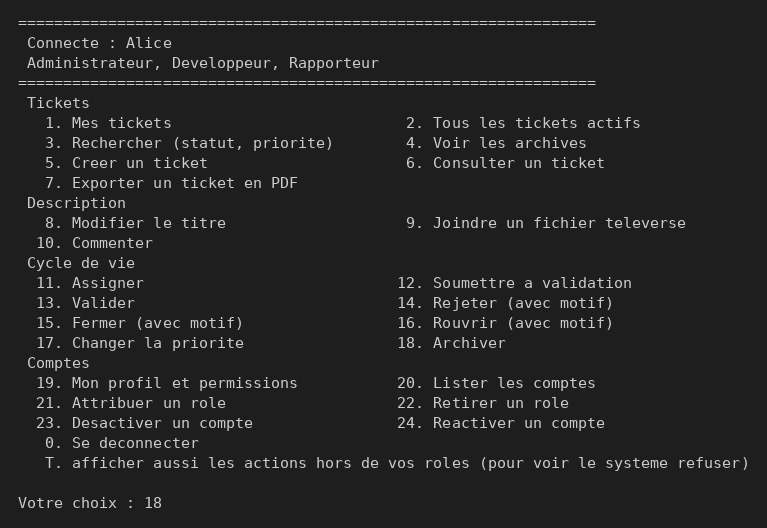

**Figure 14.** Création d'un ticket
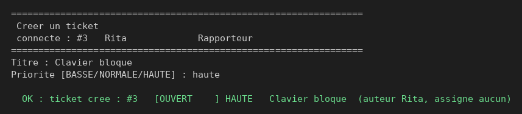

**Figure 15.** Joindre un fichier texte (accepté), puis un exécutable (refusé par la fabrique)
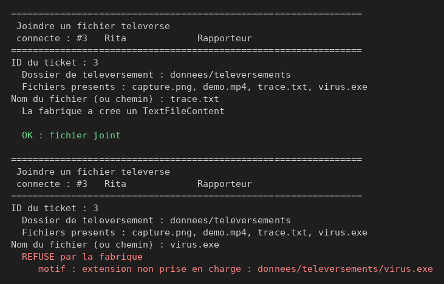

**Figure 16.** Consultation d'un ticket : texte, image et commentaire
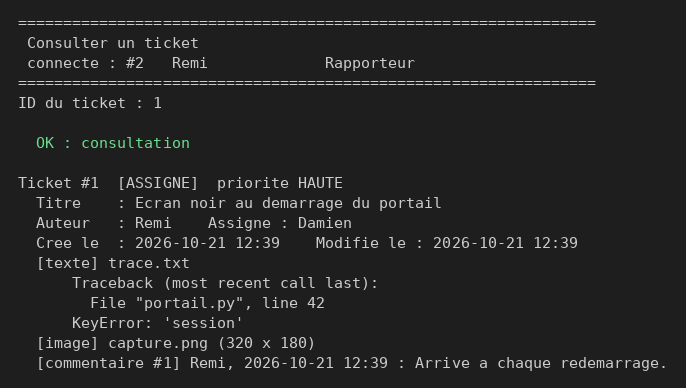

**Figure 17.** Touche `T` : les actions hors du rôle apparaissent avec `*`, et le système refuse de les exécuter
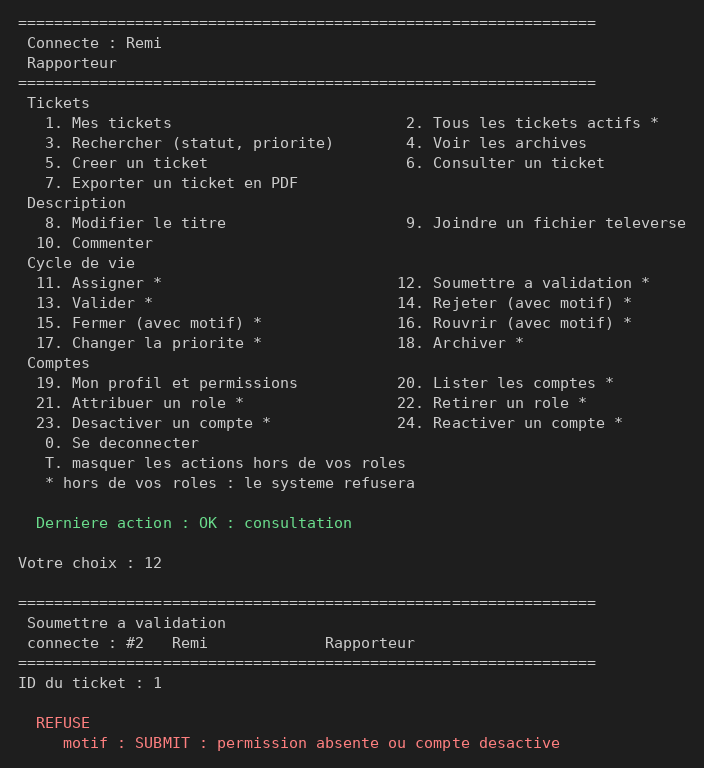

**Figure 18.** L'assigné soumet son travail (OK), puis tente de le valider lui-même (refusé)
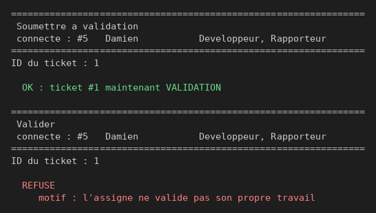

**Figure 19.** Un autre développeur valide : le ticket est TERMINÉ
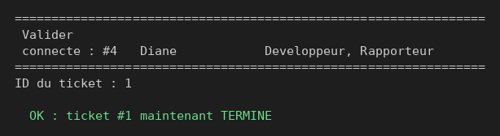

**Figure 20.** Archivage par l'administratrice, puis tentative de commentaire sur l'archive (refusée)
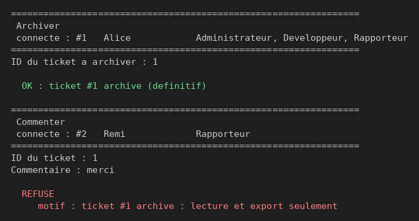

**Figure 21.** Export d'un ticket en PDF
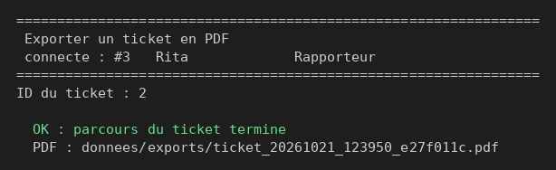

**Figure 22.** Le PDF produit, avec le texte, l'image et le commentaire
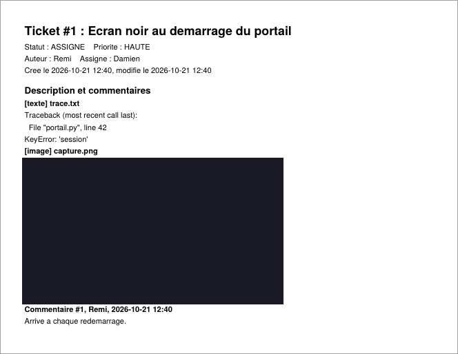

---

## 4. Organisation du dépôt

```
lab2-architecture-de-logiciel/
├── README.md                     ce document
├── Partie_1/                     implémentation du diagramme fourni
│   ├── main.py                   programme principal interactif
│   ├── user.py, admin.py, ticket.py
├── Partie_2/
│   ├── code/                     implémentation de la conception améliorée
│   │   ├── main.py               point d'entrée
│   │   ├── console.py            interface en mode console (aucune règle métier)
│   │   ├── donnees_demo.py       fichiers de départ
│   │   ├── requirements.txt
│   │   ├── gestion_tickets/      acteurs/, ticket/, consultation/
│   │   └── tests/                157 tests (conformité, architecture, règles)
│   ├── diagramme_uml.png         diagramme de classes amélioré
│   ├── diagramme_uml.puml        son source PlantUML
│   └── Rapport_Lab2_6GEI311.pdf  rapport (critique, justifications, leçons)
├── docs/
│   ├── Description_partie_1.pdf  énoncé de la partie 1
│   ├── Enonce_Lab2_6GEI311.pdf   énoncé complet du laboratoire 2
│   └── images/                   captures d'écran des parties 1 et 2
└── .gitignore                    fichiers générés exclus du dépôt
```
